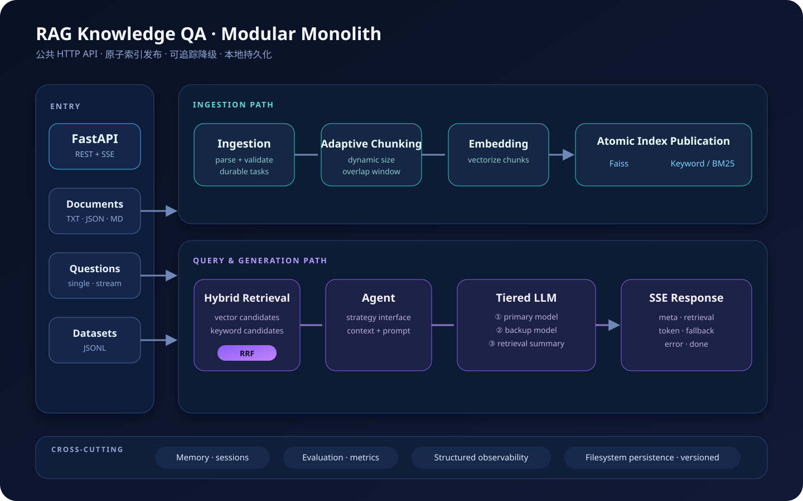

<p align="center">
  
</p>

<p align="center">
  
  
  
  
</p>

> [!IMPORTANT]
> **开发预览版**：这是一个可运行、可测试、可继续升级的全栈 RAG 系统，不是最终生产项目。当前没有认证、租户隔离、限流或恶意文件扫描，请只在本机或受信网络运行，**不要直接暴露到公网**。

## 项目简介

RAG Knowledge QA 是一个基于模块化单体后端与 Vue 3 管理台的智能知识问答系统。系统支持 TXT、JSON、Markdown 文档上传与持久任务状态，使用自适应分块、Faiss 向量召回和关键词召回构建混合检索链路，再由可扩展 Agent 组织多轮上下文、Prompt 和三级 LLM 降级。FastAPI 对外提供 REST、SSE 流式问答与 JSONL 评测接口，Vue 3 前端覆盖知识库、检索调试、流式对话和效果评测工作流。

这个仓库重点解决的不只是“能回答”，还包括索引原子发布、删除一致性、可审计降级、会话持久化、结构化安全日志和离线评测等工程问题。



## 能力状态

| 领域 | 已实现 | 规划中 |
| --- | --- | --- |
| 文档入库 | TXT / JSON / Markdown；大小与格式校验；持久任务；安全文件名；原子索引发布 | PDF / DOCX / OCR；独立任务队列；增量索引 |
| 文本处理 | 动态 Chunk Size；重叠窗口；稳定 Chunk ID | 语义边界分块；表格与代码专用分块 |
| 检索 | Faiss 向量检索；关键词检索；RRF 双路融合；向量不可用时降级 | 可学习重排；查询扩展；Milvus 适配器 |
| 问答 | 策略模式 Agent；多轮记忆；Prompt 版本管理；引用返回 | Plan-and-Execute；工具调用；引用事实核验 |
| 管理台 | Vue 3 响应式界面；文档管理；检索调试；SSE 问答；JSONL 评测 | 鉴权界面；多租户工作区；可观测看板 |
| 模型高可用 | 主模型 → 备用模型 → 检索摘要三级降级；SSE 首 token 边界 | 熔断、限流、异步供应商客户端 |
| 评测 | Hit@1、Recall@K、MRR、人工问答准确率字段；CLI / API | 版本对比看板；自动回归门禁；200 条正式数据集 |
| 工程能力 | 应用工厂；依赖注入；结构化日志；request/task/session ID；94+ 自动化测试 | 鉴权、租户隔离、可观测平台、分布式部署 |

### 指标说明

**目标指标（尚未复现）**：在 200 条自建评测集上，将首条命中率从 73% 提升到 85%+，问答准确率相对提升约 12%。仓库没有附带该 200 条数据，也没有把这些数字写成已验证结果。当前提供可重复的评测工具；只有补充真实标注集并运行后，才能形成可复现结论。

## 技术栈

- Python 3.10+、FastAPI、Pydantic Settings、Uvicorn
- Vue 3、TypeScript、Vite、Vue Router、Vitest
- LlamaIndex DashScope Embedding 适配器（不修改全局 `Settings`）
- Faiss、NumPy、自实现关键词索引与 Reciprocal Rank Fusion
- DashScope 主/备用大模型
- pytest、pytest-asyncio、httpx

## 模块结构

```text
app/
├── api/          # REST / SSE 路由与错误映射
├── agents/       # Agent 策略与注册表
├── core/         # 配置、ID、错误、结构化日志
├── domain/       # 领域模型
├── evaluation/   # JSONL 数据集、指标、CLI
├── ingestion/    # 解析、自适应分块、入库任务
├── llm/          # 模型端口、DashScope、三级路由
├── memory/       # 会话与消息持久化
├── prompts/      # Prompt 模板与版本
├── retrieval/    # Faiss、关键词、RRF、索引仓库
└── schemas/      # API 输入输出模型
scripts/
└── smoke_test.py # 仅通过公共 HTTP API 验证完整工作流
frontend/          # Vue 3 管理台、API Client 与 SSE 解析
tests/            # 单元、集成、文档契约测试
docs/             # 架构说明与 SVG 资产
```

更完整的边界、数据流、信任边界和单进程限制见[系统架构说明](docs/architecture.md)。

## 快速开始

> Vue 3 管理台位于 [`frontend/`](frontend/README.md)，对接本文档描述的全部上传、检索、问答、SSE、会话与评测接口。

### 1. 创建环境并安装依赖

Windows PowerShell：

```powershell
python -m venv venv
.\venv\Scripts\Activate.ps1
python -m pip install --upgrade pip
python -m pip install -r requirements.txt
Copy-Item .env.example .env
```

Linux / macOS：

```bash
python -m venv venv
source venv/bin/activate
python -m pip install --upgrade pip
python -m pip install -r requirements.txt
cp .env.example .env
```

### 2. 配置 DashScope

编辑 `.env`：

```dotenv
RAG_DASHSCOPE_API_KEY=your-api-key
RAG_DASHSCOPE_BASE_URL=https://dashscope.aliyuncs.com/api/v1
RAG_LLM_BASE_URL=https://dashscope.aliyuncs.com/compatible-mode/v1
RAG_EMBEDDING_MODEL=text-embedding-v3
RAG_EMBEDDING_DIMENSION=512
RAG_PRIMARY_LLM_MODEL=qwen3.8-flash
RAG_BACKUP_LLM_MODEL=qwen3.7-flash
```

`RAG_DASHSCOPE_BASE_URL` 仅供 Embedding 使用，填写 DashScope 原生 API 的完整基础地址并包含 `/api/v1`。`RAG_LLM_BASE_URL` 仅供文本生成使用，填写 OpenAI 兼容基础地址并包含 `/compatible-mode/v1`。系统不会自动追加版本路径，自定义代理或私有网关也应填写自身的完整地址。

真实文档入库需要 Embedding，因此正常运行需配置 DashScope Key。自动化测试全部使用确定性 Fake Embedding / Fake LLM，**无需 API Key**，也不会访问网络。

### 3. 启动服务

```powershell
uvicorn app.main:create_app --factory --host 127.0.0.1 --port 8000 --reload
```

启动后可访问：

- 健康检查：`http://127.0.0.1:8000/health`
- OpenAPI / Swagger：`http://127.0.0.1:8000/docs`
- OpenAPI JSON：`http://127.0.0.1:8000/openapi.json`

## API 示例

### 上传并查询任务

```bash
curl -X POST http://127.0.0.1:8000/api/v1/documents \
  -F "file=@tests/fixtures/knowledge.md;type=text/markdown"

curl http://127.0.0.1:8000/api/v1/tasks/task_xxx
```

上传返回 `202 Accepted`。客户端应轮询任务，直到 `status` 为 `succeeded` 或 `failed`，再发起检索。

### 混合检索

```bash
curl -X POST http://127.0.0.1:8000/api/v1/retrieval/search \
  -H "Content-Type: application/json" \
  -d '{"query":"退货政策是什么？","mode":"hybrid","top_k":5,"candidate_k":20}'
```

`mode` 支持 `vector`、`keyword` 和 `hybrid`。混合模式使用向量与关键词双路召回，再通过 RRF 融合排名。

### 非流式问答

```bash
curl -X POST http://127.0.0.1:8000/api/v1/chat/completions \
  -H "Content-Type: application/json" \
  -d '{"question":"如何申请退货？","retrieval_mode":"hybrid"}'
```

首次响应返回 `session_id`。后续请求携带该值即可继续多轮对话。

### SSE 流式问答

```bash
curl -N -X POST http://127.0.0.1:8000/api/v1/chat/completions/stream \
  -H "Content-Type: application/json" \
  -d '{"question":"请概括退货规则","retrieval_mode":"hybrid"}'
```

事件契约：

| 事件 | 含义 |
| --- | --- |
| `meta` | 会话 ID、Agent 策略、检索模式 |
| `retrieval` | 检索模式、降级信息和引用 |
| `token` | 增量回答与当前供应层级 |
| `fallback` | 模型切换的层级和原因码 |
| `error` | 首 token 后的模型错误；不会静默拼接其他模型 |
| `done` | 最终状态与供应层级 |

## 评测

JSONL 每行是一条查询，至少提供 `relevant_chunk_ids` 或 `relevant_document_ids`：

```json
{"query":"退货政策","relevant_document_ids":["doc_xxx"],"human_correct":true}
```

CLI：

```bash
python -m app.evaluation.cli --dataset data/evaluation.jsonl --mode hybrid --top-k 5
```

HTTP API：

```bash
curl -X POST http://127.0.0.1:8000/api/v1/evaluations/retrieval \
  -F "file=@data/evaluation.jsonl;type=application/jsonl" \
  -F "mode=hybrid" \
  -F "top_k=5"
```

报告包含 `hit_at_1`、`recall_at_k`、`mrr`，以及提供人工标签时的 `answer_accuracy`。

## 测试与完整冒烟

无需 API Key 的全量测试：

```powershell
python -m pytest -q
python -m compileall -q app scripts tests
```

服务启动并配置 Key 后，可用公共 API 跑通上传、任务、检索、问答、SSE、评测、删除和删除后检索：

```powershell
python scripts/smoke_test.py --base-url http://127.0.0.1:8000
```

脚本任一断言失败都会以非零状态退出。

## 数据与运行约束

- 默认运行目录为 `data/runtime/`，包含上传源文件、任务、会话和版本化索引；该目录已被 Git 忽略。
- 索引发布采用新版本完整写入后切换活动 manifest 的方式，避免半成品对查询可见。
- 当前锁、后台任务和本地文件存储均以单进程为边界；不要使用多个 Uvicorn worker 写同一数据目录。
- 结构化日志不记录 API Key、完整 Prompt、问题或文档正文，只记录安全标识符、阶段、耗时和原因码。

## 旧版迁移

按明确的升级决策，旧的根目录脚本 `ask.py`、`train.py`、`config.py`、`data_loader.py`、`kb_magager.py` 已删除，用户数据与原始 FAQ 文件保持不动。新入口统一为：

```powershell
uvicorn app.main:create_app --factory
```

旧版索引与当前版本化 manifest 协议不兼容，不会自动加载。迁移细节和依赖排查见[安装与迁移排障指南](INSTALL_TROUBLESHOOTING.md)。

## Roadmap

- 引入认证、租户隔离、限流和上传内容安全检查
- 将后台任务迁移到独立队列，支持幂等重试与横向扩展
- 增加语义重排、查询扩展和 Milvus 存储适配器
- 扩展 PDF / DOCX / OCR、语义分块与结构化文档解析
- 接入 Plan-and-Execute Agent、工具权限和执行审计
- 建立真实 200 条评测集及版本化回归基线

## 文档

- [API 接口文档](docs/api.md)
- [架构说明](docs/architecture.md)
- [设计规格](docs/superpowers/specs/2026-11-13-rag-knowledge-qa-upgrade-design.md)
- [实现计划](docs/superpowers/plans/2026-11-13-rag-knowledge-qa-upgrade.md)
- [安装与迁移排障](INSTALL_TROUBLESHOOTING.md)

## License

仓库当前未提供开源许可证。在添加明确的 `LICENSE` 前，请勿假设代码可被自由复制、分发或商用。
