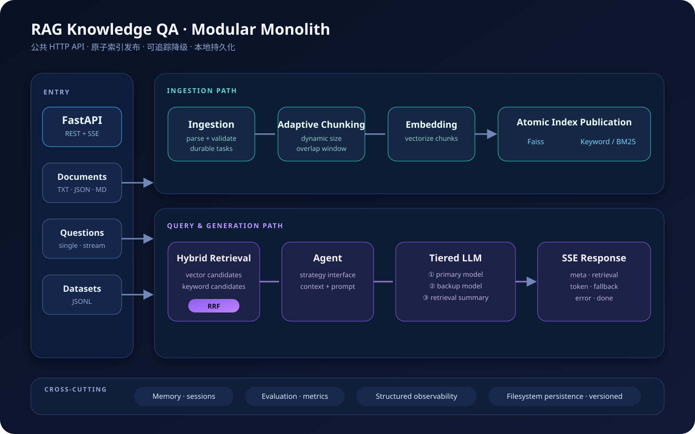

# 系统架构

本项目是一个面向学习、作品集展示和继续演进的模块化单体 RAG 后端。所有能力运行在同一个 FastAPI 进程中，但按领域边界拆分为入库、检索、Agent、模型路由、记忆和评测模块。详细决策与取舍见[设计说明](superpowers/specs/2026-11-13-rag-knowledge-qa-upgrade-design.md)。

## 服务边界

- `app/api` 只负责 HTTP/SSE 协议、请求校验和响应映射。
- `app/ingestion` 负责多格式解析、自适应分块、向量化和持久任务状态。
- `app/retrieval` 封装 Faiss、关键词索引、RRF 融合以及向量服务不可用时的降级。
- `app/agents` 通过策略接口组织上下文检索与生成，便于后续接入 Plan-and-Execute。
- `app/memory` 保存多轮会话；`app/prompts` 对 Prompt 模板做显式版本管理。
- `app/llm` 隔离模型供应商，并提供主模型、备用模型、检索摘要三级降级。
- `app/evaluation` 使用与线上请求相同的检索服务计算 Hit@1、Recall@K 和 MRR。

## 入库与原子发布

文档上传后首先产生可查询的持久任务。后台任务完成格式校验、解析和自适应分块，再批量生成向量。`IndexRepository` 将 chunk 元数据、Faiss 向量索引、关键词索引和 manifest 写入新的版本目录，全部完成后才切换活动版本。删除文档同样发布一个不再包含目标文档的新快照，并保留删除墓碑，避免部分写入被查询链路看见。

当前实现采用进程内锁串行化索引发布，适合单进程开发预览。生产化时应将任务队列、分布式锁和对象存储纳入发布协议。

## 查询、生成与降级

查询可以选择 `vector`、`keyword` 或 `hybrid`。混合模式分别召回向量与关键词候选，再使用 RRF 合并排名。Agent 将有限长度的历史、检索上下文和当前问题填入版本化 Prompt，随后调用三级模型路由：

1. 主模型正常生成；
2. 主模型在首个 token 前不可用时切换备用模型；
3. 两个模型均不可用时，根据引用生成可审计的检索摘要。

流式响应使用 SSE 发出 `meta`、`retrieval`、`token`、`fallback`、`error` 和 `done` 事件。首个 token 发出后的模型错误不会静默切换，以免拼接不同模型的内容。

## 持久化布局

运行数据默认位于 `data/`：上传源文件、任务、会话、文档清单、删除墓碑和版本化索引分别落盘。仓库保留的旧索引文件不属于新 manifest 协议，不会被自动载入。运行目录不应提交版本控制，也不应作为跨主机共享存储直接挂载。

## 信任边界与日志

上传内容、问题和外部模型输出均属于不可信数据。解析器限制文件类型和大小；服务生成存储路径，不使用客户端路径；API 通过 Pydantic 校验边界参数。结构化日志只记录请求、任务、会话等标识符、阶段、耗时和原因码，不记录 API Key、完整 Prompt、问题或文档正文。

当前版本没有认证、租户隔离、限流、恶意文件扫描或内容安全网关，因此只能在受信网络中运行，不应直接暴露到公网。

## 已知单进程限制

- `BackgroundTasks` 不是独立任务队列；进程退出时正在运行的任务会被标记为中断并允许重试。
- 文件锁只在当前进程内生效，多 worker 同时写入可能竞争。
- 会话和索引以本地文件持久化，没有高可用复制或分布式事务。
- Faiss 索引采用整版重建和切换，适合中小规模知识库，不适合高频海量增量写入。
- 结构化日志尚未接入集中式追踪后端，当前通过 request/task/session ID 进行人工关联。
